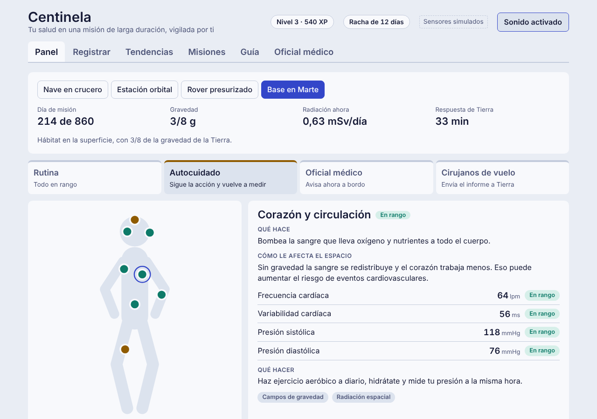

# Centinela

Monitoreo de salud para astronautas en misiones de larga duración. Proyecto para el **NASA Space Apps Challenge 2026**, evento local Lima, Perú, reto «Crear software de monitoreo de la salud para astronautas en misiones espaciales».



En una misión a Marte cada consulta a Tierra tarda minutos en ir y volver, así que el astronauta debe detectar y atender sus propios cambios de salud. Centinela recopila sus indicadores, le muestra en un cuerpo interactivo qué sistema está en riesgo, le dice qué hacer y cuándo avisar a los cirujanos de vuelo.

## Qué incluye

- **Cuerpo interactivo** con ocho zonas: mente y sueño, ojos, equilibrio, pulmones, corazón, defensas, metabolismo, huesos y músculos. Cada una explica qué hace, cómo le afecta el espacio y su estado.
- **Código de colores** verde, ámbar y rojo en todo el sistema, y una **escalera de atención** de cuatro niveles: rutina, autocuidado, oficial médico y cirujanos de vuelo.
- **Registro** por teclado y clics, con «Cómo se mide» en cada indicador, incluida la glucosa en mg/dL.
- **Pulso con la cámara** del teléfono, cubriendo la lente y el flash con el dedo.
- **Prueba de reflejos** para detectar fatiga.
- **Cuatro entornos:** nave en crucero, estación orbital, rover y base en Marte.
- **Seis emergencias** para ensayar: tormenta solar, falla de CO₂, insomnio, taquicardia, glucosa baja.
- **Tendencias** de 30 días y **proyección** de densidad ósea y radiación hasta el regreso.
- **Misiones diarias** con experiencia, nivel, racha e insignias.
- **Oficial médico** con motor de reglas local e **informe para Tierra** listo para copiar.

## Cómo ejecutarlo

Abre `index.html` en un navegador. No necesita instalación ni servidor.

El pulso por cámara necesita una página con https, por ejemplo GitHub Pages: en el repositorio, **Settings → Pages → rama `main`, carpeta `/ (root)`**.

## Estructura

```
centinela/
├── index.html
├── css/        tokens, base, panel, vistas, responsive
├── js/
│   ├── utils.js        utilidades
│   ├── data.js         indicadores, rangos, zonas, entornos, peligros
│   ├── state.js        estado, historial y modelo de la misión
│   ├── evaluate.js     niveles, escalera de atención y acciones
│   ├── services.js     sonido, voz y asistente
│   ├── simulation.js   sensores simulados y emergencias
│   ├── ui-panel.js     panel y cuerpo interactivo
│   ├── registro.js     registro, pulso por cámara y reflejos
│   ├── tendencias.js   gráficos y proyección
│   ├── misiones.js     misiones e insignias
│   ├── guia.js         guía de peligros e indicadores
│   ├── asistente.js    oficial médico e informe
│   └── main.js         rutas e inicio
└── docs/
    ├── DOCUMENTACION.md   Misión 1, 2 y 3
    ├── prototipo/         bocetos de baja fidelidad
    └── capturas/          pantallas de la versión 1.0
```

## Documentación

La documentación completa, organizada en Misión 1 (define el problema), Misión 2 (planifica el prototipo) y Misión 3 (construye), está en [`docs/DOCUMENTACION.md`](docs/DOCUMENTACION.md).

## Limitaciones

Los sensores continuos son simulados. Los rangos de color y el modelo de proyección son simplificaciones del prototipo, sin validación clínica. Centinela no es un dispositivo médico.

## Datos

Programa de Investigación Humana de la NASA y Agencia Espacial Canadiense; mediciones de radiación del rover Curiosity. La NASA no respalda este proyecto.

## Uso de inteligencia artificial

El código, los bocetos y la documentación se generaron con ayuda de Claude (Anthropic) y fueron revisados por el equipo.

## Equipo

| Integrante | Usuario |
| --- | --- |
| Miguel Ángel Portal López (líder) | @loxware |
| Joseph Mariano Henríquez Alfaro | @jojoalfz |
| Joseph Iván Merino Rojas | @josephmr |
| Diego José Díaz Peralta | @diandres |
| Eduardo Fidel Cisneros Isuiza | @eduardo_cis |
| Darwin Dionicio | @eldarwin |
