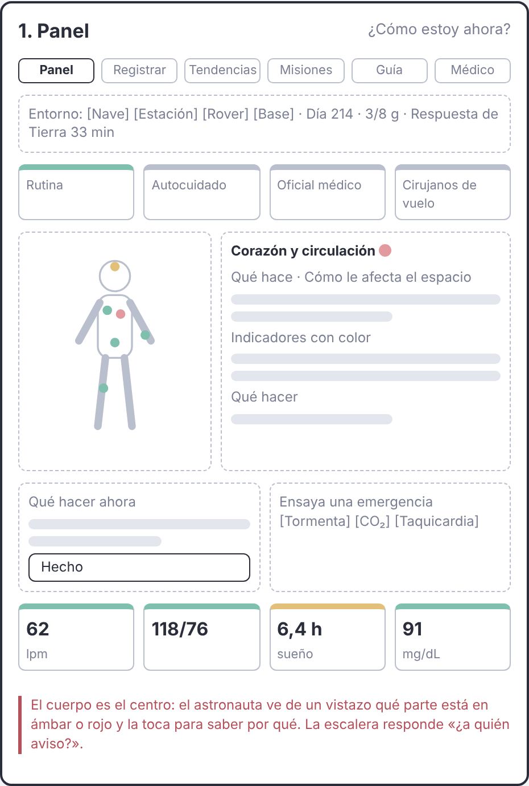
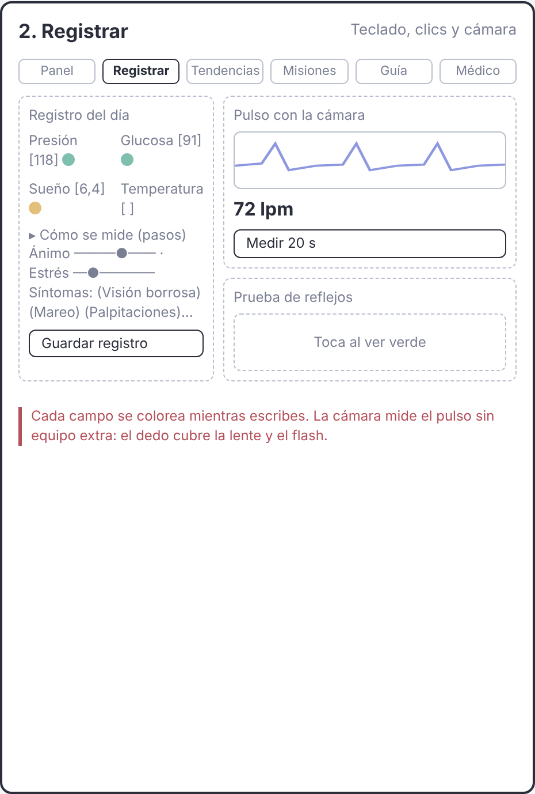
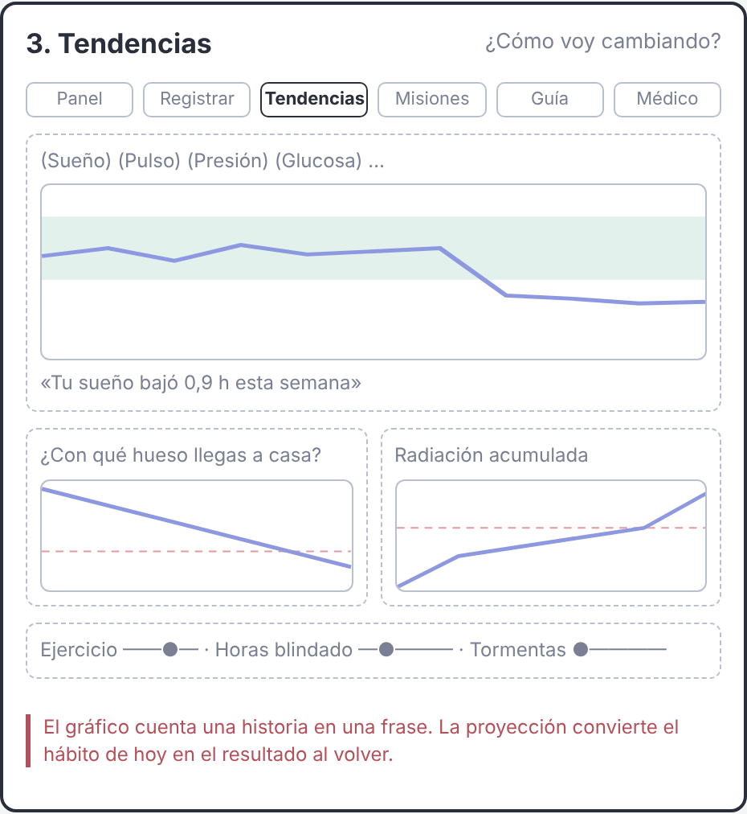
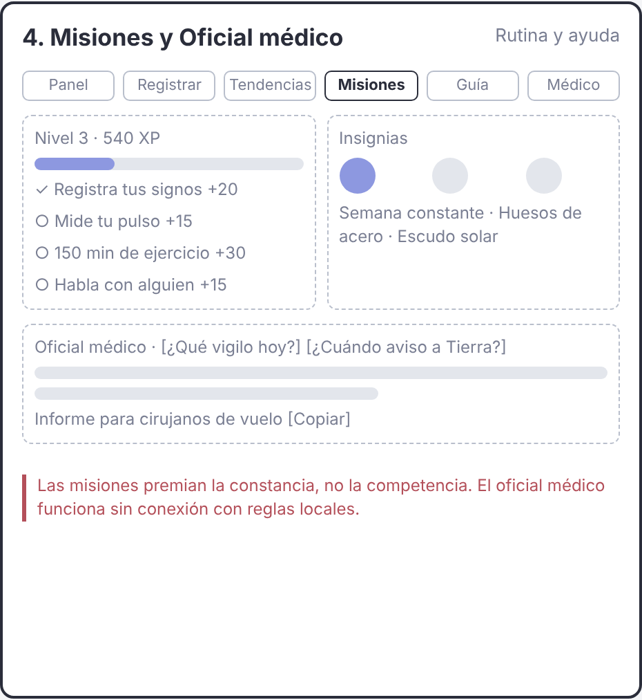
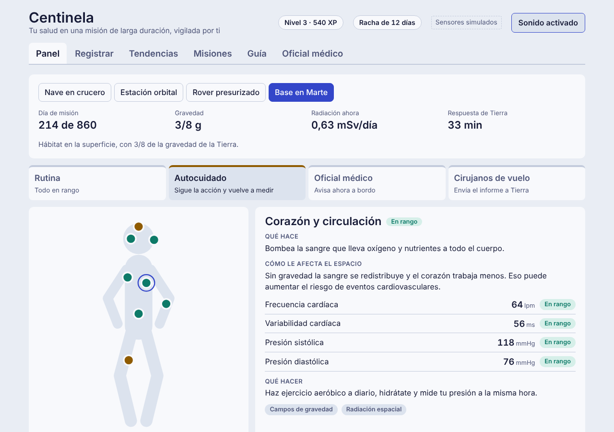
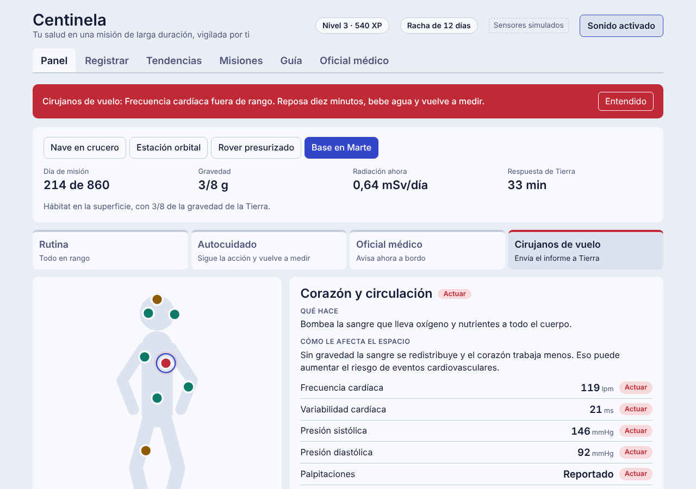
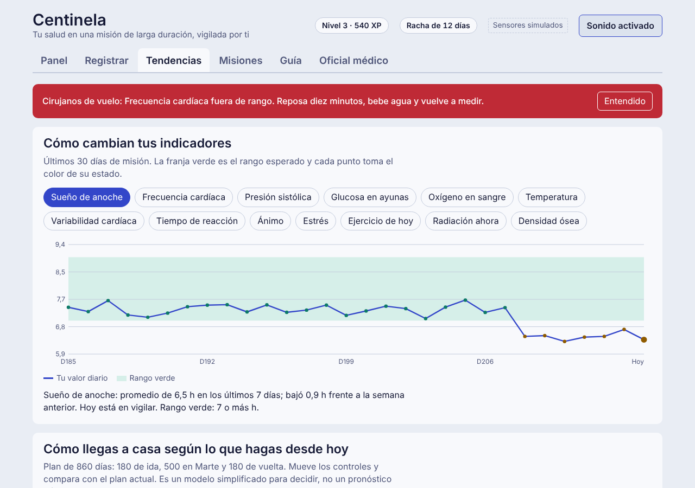
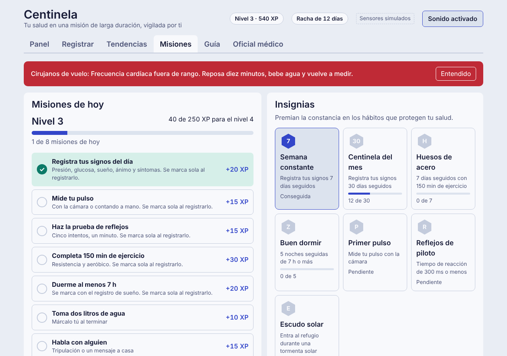

# Centinela: documentación del proyecto

NASA Space Apps Challenge 2026 · Evento local Lima, Perú · Reto «Crear software de monitoreo de la salud para astronautas en misiones espaciales»

Centinela es una consola web que recopila indicadores de salud del astronauta, le muestra en un cuerpo interactivo qué sistema está en riesgo y le dice qué hacer sin esperar a Tierra.

- [Misión 1: Define el problema](#misión-1-define-el-problema)
- [Misión 2: Planifica el prototipo](#misión-2-planifica-el-prototipo)
- [Misión 3: Construye](#misión-3-construye)
- [Fuentes](#fuentes)

## Misión 1: Define el problema

En una misión a Marte la tripulación tendrá que detectar y atender sola sus problemas de salud, porque Tierra queda lejos y cada consulta llega con minutos de retraso. Centinela convierte las mediciones diarias en un estado claro y una acción concreta.

### Reto

El reto pide una herramienta visual que ayude a los astronautas a evaluar su propia salud durante la misión y les oriente sobre tratamientos y mejoras. Los datos pueden entrar por teclado, clics o cámara, siempre que representen un indicador de salud, por ejemplo glucosa en mg/dL. Sugiere una figura humana donde cada parte del cuerpo muestre su función y su estado, gamificación, gráficos que cambien en el tiempo y código de colores.

### Problema

La NASA agrupa los peligros del vuelo espacial en cinco: radiación, aislamiento y confinamiento, distancia a la Tierra, campos de gravedad y entornos cerrados u hostiles. Estos peligros se suman entre sí y producen cambios inmunológicos, pérdida ósea, eventos cardiovasculares y problemas de conducta. Marte está en promedio a 140 millones de millas y la misión duraría unos tres años, así que la autosuficiencia es clave.

Tres preguntas guían el diseño:

1. ¿Qué puede medir el astronauta a bordo y cómo lo hace bien?
2. ¿Cuándo un resultado merece la atención de la tripulación o de los cirujanos de vuelo en Tierra?
3. ¿Qué acción previene que un cambio se vuelva crítico?

### Datos de la NASA y la CSA que usamos

| Peligro | Riesgo para la salud | Dato que usamos | Indicador en Centinela |
| --- | --- | --- | --- |
| Radiación | Cáncer inducido por radiación | 1,84 mSv/día en crucero y 0,64 mSv/día en la superficie de Marte, medidos por Curiosity; misión completa cerca de 1.010 mSv | Dosis diaria y acumulada |
| Radiación | Exposición a neutrones | Los neutrones aportan cerca del 30 % de la radiación en la EEI; la CSA desarrolla el espectrómetro CANS | Dosis con alerta por tormenta solar |
| Radiación | Límite de carrera | Límite propuesto de 600 mSv; una misión a Marte lo superaría | Porcentaje del límite consumido |
| Gravedad | Cambios óseos | Pérdida de 1 % a 1,5 % de densidad al mes en columna y cadera (NASA); 1 % a 2 % según la CSA | Densidad ósea y minutos de ejercicio |
| Gravedad | Adaptaciones cardiovasculares | La ingravidez altera la circulación y puede aumentar eventos cardiovasculares | Presión arterial, frecuencia y variabilidad cardíaca |
| Gravedad | Síndrome neuro-ocular (SANS) | Los ojos y el cerebro cambian de estructura en vuelo | Visión borrosa reportada y examen de retina |
| Gravedad | Función vestibular | Mareo y descoordinación al cambiar de gravedad; Marte tiene 3/8 de la gravedad terrestre | Náusea, mareo y prueba de reflejos |
| Entorno cerrado | Sistema inmune alterado | El estrés reactiva virus latentes y provoca erupciones | Temperatura, erupciones y congestión |
| Entorno cerrado | Hipoxia y CO₂ | Riesgo de hipoxia leve y CO₂ alto en caminatas espaciales | Saturación de oxígeno y CO₂ de cabina |
| Entorno cerrado | Alimentación inadecuada | Una dieta balanceada sostiene la salud y el rendimiento | Glucosa en mg/dL |
| Aislamiento | Conducta y trastornos psiquiátricos | El aislamiento y la distancia afectan la salud mental | Ánimo y estrés diarios |
| Aislamiento | Sueño insuficiente y horarios irregulares | Pérdida crónica de sueño y reloj biológico alterado | Horas de sueño y tiempo de reacción |
| Distancia | Apoyo operativo insuficiente | La tripulación debe resolver problemas sin ayuda inmediata | Guía paso a paso y reglas de escalamiento |

Tres estudios en curso de la NASA inspiran qué medir: ARCHeR registra actividad, sueño y luz con un dispositivo de muñeca en Artemis II; Standard Measures reúne un conjunto fijo de mediciones físicas y psicológicas; y Tempus Pro probó un equipo de telemedicina que integra datos de salud para diagnósticos remotos.

### Roles

Propuesta de reparto, a confirmar por el equipo.

| Integrante | Usuario | Rol propuesto |
| --- | --- | --- |
| Miguel Ángel Portal López | @loxware | Líder del equipo, integración y presentación |
| Joseph Mariano Henríquez Alfaro | @jojoalfz | Investigación de datos NASA y CSA, modelo de riesgo |
| Joseph Iván Merino Rojas | @josephmr | Cuerpo interactivo y panel principal |
| Diego José Díaz Peralta | @diandres | Gráficos de tendencias y proyección |
| Eduardo Fidel Cisneros Isuiza | @eduardo_cis | Registro de mediciones, pulso por cámara y pruebas |
| Darwin Dionicio | @eldarwin | Misiones diarias, documentación y video de presentación |

## Misión 2: Planifica el prototipo

El prototipo muestra en tres minutos el ciclo completo que pide el reto: medir, ver el estado en el cuerpo, actuar y saber cuándo avisar a Tierra.

### Qué mostraremos

1. **Panel en un día normal.** Base en Marte, día 214 de 860, respuesta de Tierra de 33 minutos. Se toca la cadera en el cuerpo y aparece qué hace el hueso, cómo le afecta el espacio y sus indicadores con color.
2. **Registro.** Se escriben presión y glucosa en mg/dL y cada campo cambia de color al instante. Con el teléfono se mide el pulso cubriendo la cámara con el dedo.
3. **Emergencia ensayada: taquicardia en reposo.** Suena la alerta, el corazón pasa a rojo y la escalera de atención sube a «Cirujanos de vuelo». Se prepara el informe para Tierra con un clic.
4. **Acción.** Al marcar «Reposa diez minutos» el pulso vuelve a bajar y el astronauta gana experiencia.
5. **Tendencias.** El sueño bajó 0,9 h esta semana. La proyección muestra que la radiación de la misión supera los 600 mSv aun con más blindaje.
6. **Misiones e insignias.** Las tareas de salud del día y la racha de registros.

### Decisiones de diseño

- **El cuerpo es la pantalla principal.** Ocho zonas cubren los riesgos de la NASA, de la mente a los huesos.
- **Tres colores y cuatro niveles de atención.** Verde, ámbar y rojo por indicador; rutina, autocuidado, oficial médico y cirujanos de vuelo para responder «¿a quién aviso?».
- **Explicar antes que asumir.** Cada indicador trae cómo medirlo y por qué importa.
- **Funciona sin conexión.** HTML, CSS y JavaScript sin servidor ni instalación.
- **Tres formas de entrada.** Teclado para valores, clics para síntomas y ánimo, cámara para el pulso.

### El ciclo que guía la app

```
Medir ──► Evaluar ──► Actuar ──(si sigue en rojo)──► Escalar
  ▲                     │
  └──── vuelve a medir ─┘
```

### Bocetos

Fuente: [`prototipo/index.html`](prototipo/index.html)






### Quién hace qué

| Integrante | Entregable | Archivos |
| --- | --- | --- |
| Miguel Ángel Portal López | Integración, guion de la demo y presentación | `index.html`, `js/main.js` |
| Joseph Mariano Henríquez Alfaro | Indicadores, rangos y reglas de escalamiento | `js/data.js`, `js/evaluate.js` |
| Joseph Iván Merino Rojas | Panel y cuerpo interactivo | `js/ui-panel.js`, `css/panel.css` |
| Diego José Díaz Peralta | Tendencias y proyección de la misión | `js/tendencias.js`, `js/state.js` |
| Eduardo Fidel Cisneros Isuiza | Registro, pulso por cámara y prueba de reflejos | `js/registro.js`, `css/vistas.css` |
| Darwin Dionicio | Misiones, guía, oficial médico y video | `js/misiones.js`, `js/guia.js`, `js/asistente.js` |

## Misión 3: Construye

La versión 1.0 funciona en cualquier navegador sin instalar nada y cubre todas las sugerencias del reto.

### Qué hace

| Función | Qué parte del reto responde |
| --- | --- |
| Cuerpo con ocho zonas clicables, cada una con su función, efecto del espacio, indicadores y cuidado | Figura humana donde cada parte muestra su función y estado |
| Verde, ámbar y rojo en zonas, tarjetas, gráficos y campos del registro | Código de colores |
| Registro de presión, pulso, glucosa en mg/dL, temperatura, oxígeno, sueño, ejercicio, ánimo, estrés y diez síntomas | Entrada por teclado y clics |
| Pulso medido con la cámara y el flash del teléfono | Entrada por imágenes de la cámara |
| «Cómo se mide» y «Por qué importa» en cada indicador; guía de los cinco peligros | Instrucciones sencillas |
| Escalera de atención de cuatro niveles e informe listo para copiar a Tierra | Cuándo avisar a la tripulación o a los cirujanos de vuelo |
| Lista «Qué hacer ahora» y seis emergencias ensayables | Acciones para prevenir una condición crítica |
| Selector de nave en crucero, estación orbital, rover y base en Marte | Diferentes entornos |
| Tendencias de 30 días y proyección de hueso y radiación hasta el regreso | Gráficos dinámicos |
| Ocho misiones diarias con experiencia, nivel, racha e insignias | Gamificación |
| Oficial médico con motor de reglas local | Orientación sobre tratamientos y mejoras |

### Capturas






### Cómo funciona por dentro

1. **Entrada.** `simulation.js` simula los sensores continuos; `registro.js` recibe lo que el astronauta escribe, la cámara y la prueba de reflejos.
2. **Estado.** `state.js` guarda los valores del día, el historial de 30 días y el modelo de la misión.
3. **Evaluación.** `evaluate.js` aplica los rangos de `data.js`, toma el peor nivel por zona, decide el nivel de atención y arma las acciones.
4. **Presentación.** Las seis vistas se redibujan cada segundo con el estado nuevo.

### Supuestos del modelo

| Supuesto | Valor | Base |
| --- | --- | --- |
| Plan de la misión | 180 días de ida, 500 en Marte, 180 de vuelta | Escenario usado con los datos de Curiosity |
| Radiación en crucero | 1,84 mSv/día | Medición de Curiosity |
| Radiación en la superficie de Marte | 0,64 mSv/día | Medición de Curiosity |
| Radiación en órbita baja | 0,5 mSv/día | Aproximado |
| Límite de carrera | 600 mSv | Propuesta citada por Scientific American |
| Pérdida ósea sin gravedad | 1,25 % al mes | Punto medio del rango de la NASA |
| Pérdida ósea en Marte | Proporcional a la gravedad que falta | Supuesto del equipo |
| Efecto del ejercicio | Reduce la pérdida hasta 60 % | Supuesto del equipo |
| Refugio blindado | Hasta 30 % menos dosis con 16 h diarias | Supuesto del equipo |
| Tormenta solar | 25 mSv adicionales | Supuesto del equipo |
| Retardo de comunicación | 3 a 22 minutos por sentido | Aproximado |
| Rangos verde, ámbar y rojo | Valores clínicos generales | Sin validación médica |

Con el plan base el modelo da unos 1.007 mSv al volver, en línea con los 1.010 mSv que estimó el equipo de Curiosity, y supera el límite de 600 mSv aun con 16 h diarias de blindaje.

### Limitaciones

- Los sensores continuos son simulados y el historial de 30 días es de ejemplo.
- Los rangos y el modelo no tienen validación clínica; Centinela no es un dispositivo médico.
- El pulso por cámara depende de la luz y del teléfono, y aún no se probó con un dedo real.
- Los datos quedan en el navegador de cada dispositivo.

### Próximos pasos

- Conectar sensores reales por Bluetooth: pulsera, oxímetro y tensiómetro.
- Revisar los rangos con un médico.
- Un panel para el oficial médico con el estado de toda la tripulación.
- Exportar el historial completo para los cirujanos de vuelo.

## Fuentes

La NASA no respalda este proyecto.

- [NASA HRP: 5 peligros del vuelo espacial tripulado](https://www.nasa.gov/hrp/hazards/)
- [NASA HRP: Riesgos del vuelo espacial tripulado](https://www.nasa.gov/hrp/risks/)
- [NASA HRP: Investigación en curso](https://www.nasa.gov/hrp/ongoing-hrp-research/)
- [NASA: Riesgo de cambios óseos inducidos por el vuelo espacial](https://www.nasa.gov/reference/risk-of-spaceflight-induced-bone-changes/)
- [CSA: Monitoreo de la radiación para la salud de los astronautas](https://www.asc-csa.gc.ca/eng/news/articles/2026/2026-02-26-monitoring-radiation-astronaut-health.asp)
- [CSA: ¿Por qué hacemos experimentos científicos en el espacio?](https://www.asc-csa.gc.ca/eng/iss/science/why-do-we-conduct-science-experiments-in-space.asp)
- [CSA: ¿Qué les pasa a los huesos en el espacio?](https://www.asc-csa.gc.ca/eng/sciences/osm/bones.asp)
- [Space.com: Radiación medida por Curiosity](https://www.space.com/23875-mars-radiation-life-manned-mission.html)
- [Scientific American: Nuevo límite de radiación para astronautas](https://www.scientificamerican.com/article/new-space-radiation-limits-needed-for-nasa-astronauts-report-says/)

## Uso de inteligencia artificial

El código, los bocetos y esta documentación se generaron con ayuda de Claude (Anthropic) y fueron revisados por el equipo.
